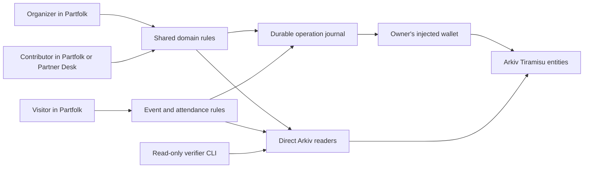

# Partfolk


**Find an event. Make one happen.**

Partfolk brings organizers, contributors and visitors into one event ecosystem. Organizers combine people, spaces and equipment into a workable event; contributors keep control of what they offer and which exact arrangement they accept; visitors discover published events and manage their registration.

The shared record lives on **Arkiv**. Each contributor owns their offers and decisions, so an organizer cannot turn someone else's old agreement into approval of a changed plan. Independent clients can read the same records and verify the agreed version without Partfolk's application server or a private account database.

**Current availability:** runnable locally, with public Arkiv integration implemented. A hosted production URL, a complete live product demonstration and final user browser acceptance are pending. The included network evidence establishes earlier SDK capabilities, not the entire product journey.

## Try it locally

Use **Node.js 22.12.0 or newer** and npm. From the checked-out repository directory:

```sh
npm ci
npm run dev
```

On Windows PowerShell, use `npm.cmd` instead of `npm`, especially when forwarding arguments after `--`. Development has been checked on Windows with Node.js 22.13.0 and npm 10.9.2; other operating systems have not been independently verified for this release.

| Local destination | What to open |
| --- | --- |
| Partfolk | [http://127.0.0.1:5173/](http://127.0.0.1:5173/) |
| Guided Small Works example | [http://127.0.0.1:5173/#/demo](http://127.0.0.1:5173/#/demo) |
| Published events | [http://127.0.0.1:5173/#/events](http://127.0.0.1:5173/#/events) |
| My projects and drafts | [http://127.0.0.1:5173/#/workspace](http://127.0.0.1:5173/#/workspace) |

These are local addresses and work while the development server is running. Vite uses a strict port: if 5173 is occupied, startup fails instead of changing the address. Stop with Ctrl+C and use the same command to restart.

Successful startup prints the local URL. An HTTP check can confirm that the entry page is served without opening a browser:

```sh
node --input-type=module -e "const r = await fetch('http://127.0.0.1:5173/'); console.log(r.status); if (!r.ok) process.exitCode = 1;"
```

Expect `200`. This confirms server reachability, not the user flow or wallet interaction.

No environment file, API key, container, application database or migration is required. The example is initialized when you open it. Reading public events and trying the local example need no wallet. An empty public catalogue means no verified matching events were returned; it is not populated with fictional events.

## A first useful session

Open the guided **Small Works** example. A shared exhibition needs a venue, display boards, equipment, installers, hosts and artwork transport. Saturday lacks enough boards. Sunday has the resources, but Cedar cannot install and transport artworks at the same time.

1. Choose **Add Oak and find a plan**. Oak handles transport, leaving Cedar and Willow available to install. A proposal includes the equipment handover and return.
2. Choose **Play the group's agreement**. The example records a separate local decision for every required contributor. The plan becomes ready only after those decisions agree with the same version.
3. Choose **Let Oak withdraw**. The existing plan loses readiness; the earlier agreements remain attached to their original version.
4. Choose **Add Juniper and update the plan**. Juniper installs with Willow, freeing Cedar for transport. Choose **Play fresh agreement** to approve the revised arrangement.
5. Choose **Explore the full project**. Inspect the people, exact agreement, history and run sheet. In the full practice, switch between fictional roles to record their own work and equipment transfers. Export the outcome as JSON or a readable HTML run sheet.

This example uses the real local domain operations with fictional identities and a controlled practice clock. Its group-agreement buttons simulate the separate owners for learning; they never sign public agreements. Progress survives reload in the same browser, and **Start the example again** resets only the example.

To make your own event, choose **Create an event** or **Start my own project**. Enter a title, outcome, time zone, date/place options and required people or resources. Your draft appears in **My projects**, where you can reopen, export, import or delete it. Publishing is an explicit wallet action. Copying or reusing a recipe starts new work without inheriting another project's approvals.

## One event, three ways to take part

| Role | Work in Partfolk | Result |
| --- | --- | --- |
| Organizer | Describe needs; review and admit incoming offers; compare feasible arrangements; publish an exact proposal; request agreement; publish the visitor page and run the event | A coordinated event with an inspectable agreement, registration policy and history |
| Contributor | Offer time, a place or equipment; declare availability and capacity; review requests; accept, decline or withdraw their own commitment; report work and acknowledge transfers | Control of their own resources and decisions across projects |
| Visitor | Browse by title, dates, format, country/city, availability and deadline; review public details; register or request a place; reconfirm changed terms; withdraw | Registrations and current event details together in **My events** |

The same wallet can do all three. Signing in connects an injected Ethereum-compatible wallet to Arkiv Tiramisu. It does not create a public profile, publish a project or approve anything. Device preferences choose a starting page; a modal welcome tour introduces the workspace and can be replayed from Help.

### Places, formats and registration

An event can be **online**, **in person** or **hybrid**. Physical events have a country, city and venue; online participation has a public HTTPS address or public joining instructions. Dates use a named IANA time zone. Catalogue date filters use the visitor's local zone, while each event displays its own zone.

Organizers can set a registration deadline, unlimited or limited capacity, an optional waiting list for limited events, and open or wallet-invitation-only admission. They can close registration, reopen it after validation, cancel the event or mark it ended. New registration also stops after the scheduled end or when the underlying contributor agreement is no longer ready.

An ordinary signup must be included onchain before its deadline, which can be set up to the event end. The client's typed timestamp cannot backdate a late request. A timely request can be admitted later. The waiting list is displayed by creation block and then entity key, while the organizer chooses admissions.

For unlimited open events, a valid attendee decision registers directly. Limited and invitation-only events use **organizer admission**: a signed request is pending until the organizer reserves a place for that exact request and event release. Joining the waiting list is an explicit choice. A displayed count or request alone is not a reservation, and withdrawal does not automatically promote a waiter.

Seat changes create a successor event state and consume the exact reviewed previous state in one native Arkiv batch. Two competing updates cannot both consume that same predecessor. Capacity is checked against the retained reservations; it is not inferred from a browser counter. Missing or conflicting request evidence remains unverified and does not silently free a seat. The organizer explicitly releases or replaces reservations.

Public event terms are immutable releases. Changing a date, venue or other audience terms creates a new release, preserves the old terms for comparison and requires visitors to reconfirm. Existing reservations remain occupied until explicitly released or rebound to the visitor's new exact request. Repairing only the internal contributor plan can preserve the audience release, so an unchanged visitor arrangement does not need a new attendance decision.

For managed reservations, a changed release records which held attendees the organizer authorizes to reconfirm after the deadline; a wallet must still be held and listed for that exception. The owner then admits the new exact request. For previously registered attendees without held reservations, changing terms after the deadline requires the organizer to explicitly choose a later deadline. These changes do not silently reopen ordinary registration. [The event contract](arkiv/schema.md#event-participation-extension) describes the full rules.

Registration is free of ticket payments in this implementation. A wallet invitation establishes eligibility; it does not make an event or its invitation list private. A registration is a recorded decision, not proof of physical attendance or a verified real-world identity.

### From preparation to the run sheet

The deterministic solver checks dates, resource quantities, overlapping commitments, individual availability and typed conditions. Separate offers do not allow one person to perform two simultaneous jobs. Proposed equipment handovers and returns extend the relevant reservation interval.

Every candidate passes an independent evaluator before it can become a proposal. A repair favors retaining contributors, then the chosen date/variant, then quantities and assignment terms. When the search budget is exhausted, the result reports the limit instead of claiming impossibility or a proven optimal plan.

The run sheet records tasks, handovers, recipient acknowledgements, returns and unresolved work. A planned return is not a recorded return. Completed reports and outstanding equipment custody survive a later withdrawal or project closure. Exports preserve the selected version, evidence status and outstanding obligations; importing a recipe never imports someone else's consent.

## Why Arkiv is part of the mechanism

Partfolk stores independently authored records rather than treating the organizer's page as the authority for everyone's agreement.

1. The organizer owns a project root, its working state, immutable proposals and the current activation.
2. Each contributor owns a publisher root and a current book of resources, offers, decisions, grants and execution records. Acceptance and its capacity reservation are written together in one book replacement.
3. Consent binds the exact project, activation, proposal key and canonical hash. Every material contributor-plan revision requires fresh approval from every required owner, even when someone's individual task stayed unchanged.
4. The visitor extension adds immutable event releases, an organizer-owned event state and independently owned attendance states. Visitor consent binds the exact audience release and hash.
5. A reader authenticates creators, ownership, readonly flags, schemas, hashes and indexed attributes at one canonical block. It reads every required page and derives readiness from the resulting evidence.

No single `ready` field written by the organizer decides the result. Missing evidence, expired records, stale reads and conflicting current records remain distinct from agreement. Normal replacements create the successor and delete the exact prior records atomically. The solver and policy checks run in the clients; there is no Partfolk smart contract enforcing a global lock across owners.



The full contracts are in [arkiv/schema.md](arkiv/schema.md) and [docs/protocol.md](docs/protocol.md). [arkiv/friction.md](arkiv/friction.md) records SDK constraints and implementation findings.

### What is saved where

| Data | Persistence and authority |
| --- | --- |
| Project/contribution drafts, account label, tour progress | This browser's local storage; not a public profile or cross-device backup |
| Local projects and Small Works practice | Separate local repositories; simulated local owners cannot authorize public writes |
| Published projects, offers, plans, decisions and event registrations | Public Arkiv entities, authenticated by the creating wallet and current ownership |
| Pending action and transaction journals | Origin-specific browser storage; frozen requests and evidence, never private keys |
| JSON/HTML exports | Files the user saves; dated evidence, not imported signing authority |

Returning with the same wallet lets another client discover its public records. Drafts, device settings and pending journals do not automatically move between devices or origins. Deleting a local draft does not delete a published project. Disconnecting clears signing authority while preserving saved work.

Public payloads and indexed attributes are readable by others. Keep private contact details, private meeting credentials and secrets out of them. Expiration or deletion cannot retract copies already read. Entity lifetime is a block deadline; extending storage does not renew a consent deadline or guarantee retention until a particular wall-clock date.

### Recovering an interrupted write

The writer freezes the intended action, owner, expected predecessor keys, lifetime and operation ID before sending. It persists each phase and verifies the transaction, receipt, native events and entity readback. Project initialization and proposal publication can have multiple recoverable phases.

If a response is lost, retain the same browser data and reconnect the same wallet. Use the offered request-check or continuation action to reconcile the original operation. A timeout or empty search does not establish that nothing was sent. Clearing the journal or creating a replacement request can lose the evidence needed for recovery. Detailed recovery states and operator actions are in [docs/operations.md](docs/operations.md).

## Independent clients under the same Partfolk brand

**Partner Desk** is a separate technical client for contributors and agreement inspection. It has its own entry point, runtime, storage namespace and wallet connection, and reads Arkiv directly. It demonstrates that published work remains usable without the organizer's running Studio process; it is not a second event ecosystem or a required step for ordinary users.

Start it in another terminal:

```sh
npm run dev:desk
```

Open [http://127.0.0.1:5174/desk.html](http://127.0.0.1:5174/desk.html). It accepts public project/publisher keys and supported invitation links. Public project keys contain 32 bytes (`0x` followed by 64 hexadecimal characters); `local:` identifiers belong only to local practice/work.

The read-only CLI constructs a fresh Arkiv reader without Studio or browser storage:

```sh
npm run verify -- --help
npm run verify -- PROJECT_ROOT --json
npm run verify -- PROJECT_ROOT --export project-snapshot.json
npm run verify -- PROJECT_ROOT --block 123456 --json
```

Replace `PROJECT_ROOT` with a real public project root and `123456` with the historical block you intend to inspect. `--export` refuses to overwrite an existing file. Historical output describes that block, not current readiness. The verifier checks the contributor project/agreement; event registration has its own extension reader and is not a separate CLI mode.

Exit `0` means the project produced a classified result, which may still need approval or repair. Inspect `readiness.status`, reasons, snapshot time/block, approval counts and history completeness. Unverified results/errors return `1`; missing arguments return `2`.

## Configuration, builds and checks

There are **no required or optional application environment variables** in the current runtime. Network settings are source configuration, not `.env` overrides:

| Setting | Value / source |
| --- | --- |
| Network | Arkiv Tiramisu testnet, chain ID `7738577` |
| Public RPC | `https://rpc.tiramisu.db-chain.testnet.arkiv.network` |
| Explorer | `https://tiramisu.explorer.arkiv.network` |
| Native entity address | `0x4400000000000000000000000000000000000044` |
| SDK | `@arkiv-network/sdk` `0.8.1`, locked in `package-lock.json` |
| Read configuration | [src/data/arkiv/client.ts](src/data/arkiv/client.ts) |
| Wallet configuration | [src/data/wallet/gateway.ts](src/data/wallet/gateway.ts) |

Public writes require an injected EOA wallet on Tiramisu, testnet gas, browser storage and Web Locks support. The app requests the account and switches/adds the network on connection; sending rechecks wallet and RPC chain identity. It never accepts a private key or provides a signing server. Historical wallet/probe scripts are development evidence tools, not install or seed commands.

| Command | Purpose |
| --- | --- |
| `npm run check` | Full offline product gate: TypeScript, unit/integration tests, bootstrap/probe tests, live-runner safety tests and both builds |
| `npm run typecheck` | Application TypeScript check |
| `npm run test:unit` | Domain, data, application and feature unit tests |
| `npm run test:integration` | Typed multi-role, independent-process and recovery integration tests |
| `npm run test:bootstrap` | Offline tests of historical first-write and atomic-probe scripts |
| `npm run build` | Main static bundle, including `index.html` and `desk.html`, in `dist/` |
| `npm run build:desk` | Independently deployable Desk in `dist-desk/` |
| `npm run preview` | Serve the built main bundle at `http://127.0.0.1:4173/` |
| `npm run preview:desk` | Serve the built Desk at `http://127.0.0.1:4174/desk.html` |

The check command does not broadcast transactions or use browser automation. Build before the corresponding preview command. All development and preview ports are strict. There is no `npm start` script.

For deployment, serve the contents of `dist/` over HTTPS; an independent Desk deployment serves `dist-desk/` with `desk.html` as its entry. Both builds use relative asset paths and hash routing. Keep each HTML entry with its generated assets. No server process, database migration or signing secret belongs in the deployment. Hosting configuration and a production origin are not yet delivered. See [operations](docs/operations.md) for HTTP reachability checks, recovery and lifetime maintenance.

The main implementation boundaries are:

| Path | Responsibility |
| --- | --- |
| `src/app/` | Main entry, routes, sessions, local/public/practice workspaces and recovery |
| `src/features/` | Organizer, contributor, visitor, practice, account and execution flows |
| `src/domain/` | Canonical hashing, constraints, solver, exact consent and execution |
| `src/domain/events/` | Audience terms, release hashes, attendance and admission rules |
| `src/data/arkiv/` | Authenticated block-pinned reads, native writes and verification |
| `src/data/events/` | Event extension repository using the shared transaction boundary |
| `src/data/operations/`, `src/data/wallet/` | Durable reconciliation and injected-wallet authority |
| `src/desk/`, `src/cli/` | Independent Desk and read-only verifier |

The UI uses React, TypeScript and Vite, with the official Arkiv SDK, viem and the Temporal polyfill. No AI service runs in the product.

## Evidence and current limits

On **11 October 2026**, source revision `ae4c839` passed the full product gate: 777 unit tests, 22 integration tests, 19 bootstrap/probe tests, 42 live-proof-helper safety tests and 102 live-proof-helper unit tests, together with application/integration/helper TypeScript checks and both production builds. These helper checks were offline.

A fresh isolated checkout of that revision, without private planning files, local signer data or an environment file, also passed `npm ci`, both builds and the 27-test event-domain suite on Node.js 22.13.0 / npm 10.9.2. Its development and production preview entries returned HTTP `200`; all linked assets inspected in the two production entries returned `200`. Temporary ports 5183, 4183 and 4184 kept this check separate from the existing workspace servers. No browser rendering, wallet interaction or network broadcast was part of those checks.

The repository separates several kinds of evidence:

- Unit tests exercise domain constraints, consent, authorization, malformed data, conflicts, UI state models and recovery logic.
- [Integration tests](tests/integration/README.md) use production readers/writers with a strict in-memory native ledger. They cover organizer/contributor/attendee journeys, fresh client processes, competing projects, repair, interruption recovery and execution exports. They do not broadcast to Tiramisu or prove browser behavior.
- [Bootstrap evidence](arkiv/evidence/bootstrap.json) records an actual historical SDK create/read/query check. [Atomic transition evidence](arkiv/evidence/atomic-transition.json) records A-to-B replacement and rejection of a stale A-to-C gas estimate. It explicitly records `staleBroadcast: false` and `minedRollbackTested: false`.
- [Live product proof tooling](tests/arkiv-live/README.md) exists separately. A completed funded multi-party product proof is still pending; a runner and its offline tests are not that proof.

Material limits remain visible:

- **No hosted release or completed public product demonstration is claimed here.** Final visual, mobile, accessibility-in-browser and real wallet interaction acceptance belongs to user testing and remains separate from code checks.
- **Readiness is a dated observation.** It is not escrow, a promise of future availability, a global lock across owners or proof that work happened. Owners can withdraw, delete records or let them expire.
- **Public audience details remain organizer-authored.** Publication binds a ready contributor plan, but the audience schedule and location are entered separately; the current validator does not establish that every published visitor time or venue matches the contributor duties. Organizers must check that correspondence.
- **RPC and bounded reads matter.** The default reader permits 160 pages, 4,000 entities and 50 project publishers, with 100 records per page and one cursor restart. Incomplete reads remain unverified. Proposal lineage is bounded to 32 proposals; unavailable history is shown as a gap. Snapshot confidence expires after 60 seconds.
- **Managed event sizes are bounded.** Limited capacity and invitation lists support at most 512 entries. Release/attendance payloads are bounded to 64 KiB and event state to 120 KiB. Admissions are explicit organizer decisions, not automatic first-come allocation. Missing evidence does not release a place.
- **Public does not mean permanent or private.** Records expire and clients depend on the configured RPC/indexer. Invite-only registration is public eligibility control. Wallet authorship does not establish a human identity or prevent one person using multiple wallets.
- **Browser storage is operational state.** Losing a draft or pending journal cannot be repaired from a name or a cached success label. Separate origins do not share journals or submission locks. Avoid concurrent writes from the same wallet in different clients.

## License and materials

Partfolk is available under the [MIT License](LICENSE). Bundled IBM Plex Sans files retain their [font license](public/fonts/IBM-Plex-Sans/license.txt). Library dependencies retain their respective licenses.

VibeMachina supplied development guidance for planning, design, delegated implementation and review. The application does not need that skill, private planning files or the original author's local configuration to install, run or verify public records.
