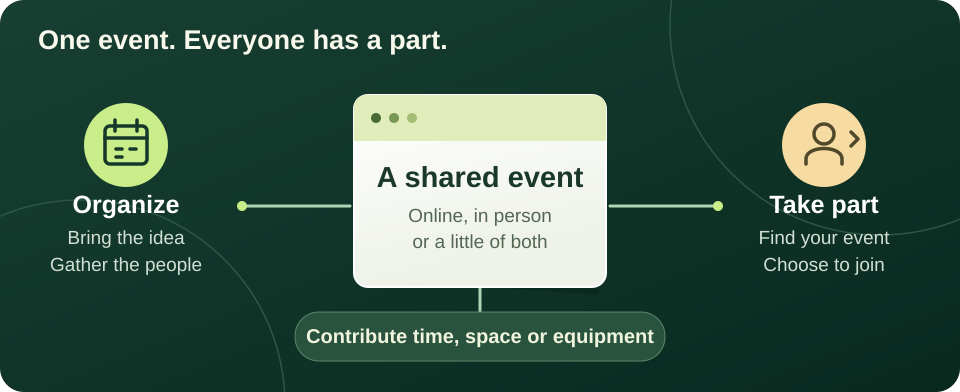
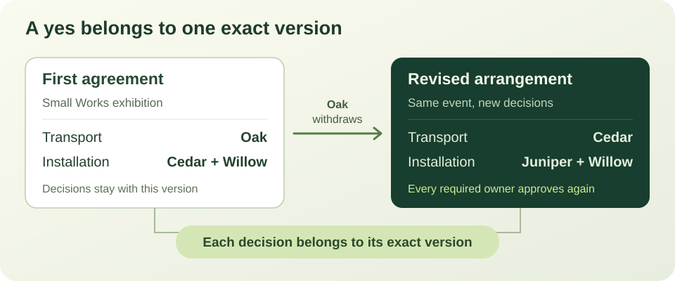
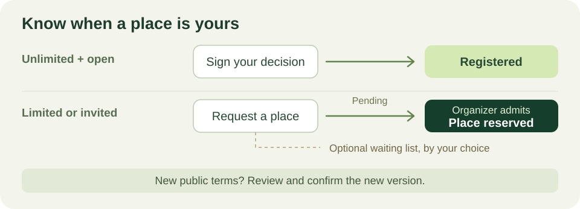
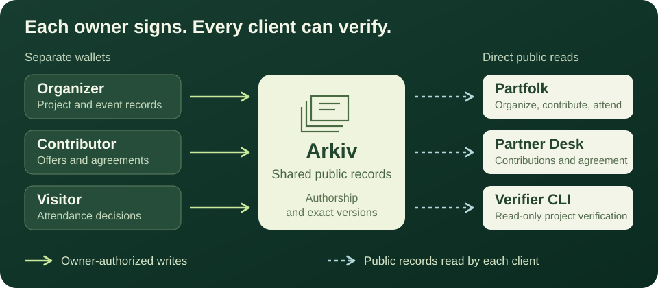

<p align="center">
  
</p>

<h1 align="center">Partfolk</h1>

<p align="center"><strong>Find an event. Make one happen.</strong></p>

<p align="center">
  Bring people, spaces and equipment together.<br>
  Keep every contribution and agreement in its owner's hands.
</p>

<p align="center">
  
  
  
  
  
  
</p>

<p align="center">
  <a href="https://partfolk.vercel.app/">Open Partfolk</a>&nbsp;&nbsp; / &nbsp;&nbsp;
  <a href="#try-partfolk">Run locally</a>&nbsp;&nbsp; / &nbsp;&nbsp;
  <a href="#see-the-mechanism-in-four-steps">Explore the example</a>&nbsp;&nbsp; / &nbsp;&nbsp;
  <a href="#why-arkiv">Why Arkiv</a>&nbsp;&nbsp; / &nbsp;&nbsp;
  <a href="docs/protocol.md">Protocol</a>
</p>

Partfolk is one ecosystem for **organizers, contributors and visitors**. Organizers turn available skills, spaces and equipment into an event. Contributors decide which exact arrangement they accept. Visitors find published events and manage their registration.

**Arkiv holds the shared record.** Offers and agreements belong to their authors, so an organizer cannot turn an old “yes” into permission for a changed plan. Independent clients can read and verify those same decisions.

https://github.com/user-attachments/assets/fa359557-5970-4713-a622-398f97467d42

**[Open Partfolk](https://partfolk.vercel.app/)** or go straight to [published events](https://partfolk.vercel.app/#/events). The hosted application uses Arkiv Tiramisu. A completed [public proof](arkiv/evidence/product-proof.json) demonstrates contributor agreement, withdrawal and fresh consent on the network.



| Your part | What you can do |
| --- | --- |
| **Organize** | Describe needs, admit contributions, compare arrangements, collect agreement, publish the visitor page and run the event |
| **Contribute** | Offer time, a space or equipment; set availability; accept, decline or withdraw commitments; record work and equipment transfers |
| **Attend** | Browse by date, format and location; check registration rules; request or reserve a place; follow changes in **My events** |

One wallet can do all three. A welcome tour introduces the workspace after sign-in and can be replayed from Help. Connecting the wallet alone does not publish a profile, create a project or approve a plan.

## Try Partfolk

Use the [hosted application](https://partfolk.vercel.app/) without installing anything. To run your own copy, use **Node.js 22.12.0 or newer** and npm. From the repository directory:

```sh
npm ci
npm run dev
```

Open [Partfolk at localhost:5173](http://127.0.0.1:5173/). No database or container is needed. Public reads work directly without a key. For a larger catalogue, an optional server-only Arkiv access key enables the same bounded read service used by the hosted app; see [network configuration](docs/operations.md#runtime-and-network-configuration). On Windows PowerShell, use `npm.cmd` instead of `npm`, especially when forwarding arguments after `--`.

| Start here | Local route |
| --- | --- |
| Explore Small Works without a wallet | [Guided example](http://127.0.0.1:5173/#/demo) |
| Find published events | [Browse events](http://127.0.0.1:5173/#/events) |
| Create or resume your own work | [My projects](http://127.0.0.1:5173/#/workspace) |

These links work while the development server is running. Port 5173 is strict; an occupied port produces an error. Stop with Ctrl+C and restart with the same command.

The local example initializes when opened. The public catalogue reads authored Arkiv records and needs no wallet for browsing. Three published synthetic events carry **TEST EVENT**, with `[PARTFOLK TEST EVENT]` on the first line of their current release's conditions. These are public test records, not invitations to real gatherings. The marker is an authored declaration, not an independent certification.

| Published test event | Date and format | Recorded registration |
| --- | --- | --- |
| [Sketchbook exchange](https://partfolk.vercel.app/#/events/0x73b09be8ed1e8f98bf76b331b3d46aedc8affe82be1e56dc7946acf28ba96299) | 24 October 2026, online | 3 going |
| [Bookbinding at a shared table](https://partfolk.vercel.app/#/events/0x4237eacdb4079255ecb729b5888d827a43300dd963f9c18fc164c8aa2d141d90) | 25 October 2026, in person, Almaty | 3 going, 1 waitlisted |
| [Community audio walk workshop](https://partfolk.vercel.app/#/events/0x7bb81a521f301f642d512752d313ba0016c3e292ee0ddf55d1e9b0725eea065c) | 26 October 2026, hybrid, London | 2 going |

These counts come from the [11 October evidence export](arkiv/evidence/test-events.json), at blocks 446077, 446084 and 446092 respectively. Catalogue filters apply to the loaded records immediately. Network reads share in-flight work and respect quota cooldowns; an unavailable refresh keeps dated results visibly unverified.

Publishing and registration require an injected Ethereum-compatible EOA wallet on **Arkiv Tiramisu**, testnet gas, browser storage and Web Locks support.

## See the mechanism in four steps

**Small Works** is a shared exhibition. Saturday lacks enough display boards. Sunday has the resources, but Cedar cannot install the exhibition and transport its artworks at the same time.



1. **Find a workable arrangement.** Choose **Add Oak and find a plan**. Oak transports the artworks; Cedar and Willow install. The proposal includes equipment delivery and return.
2. **Agree to this version.** Choose **Play the group’s agreement**. Each fictional contributor records a separate local decision. The plan becomes ready when every required agreement matches.
3. **See what changes.** Choose **Let Oak withdraw**. The old plan loses readiness, while its decisions remain attached to their original version.
4. **Repair and agree again.** Choose **Add Juniper and update the plan**, then **Play fresh agreement**. Juniper installs with Willow, freeing Cedar for transport. Every required owner reviews the new version.

Choose **Explore the full project** to inspect people, history and the run sheet. Use **Practice as** to switch fictional roles, prepare offers, record work, acknowledge handovers and export a JSON record or readable HTML run sheet. A scheduled equipment return is never treated as an actual return.

Practice uses local domain operations with fictional identities and a controlled clock. Its agreement buttons and role selector simulate the separate owners. Progress survives reload; **Start the example again** resets only the example.

**Make it yours:** choose **Create an event**, enter its purpose, date, time and time zone, then describe the place and contributions it needs. Unsent input is saved automatically while you work. Publishing requires your wallet and an explicit review. Earlier device-only projects remain available for recovery in **My projects**. Reusing a recipe starts a new public-project draft without copying anyone's approvals.

## Events people can actually join

Events can be **online**, **in person** or **hybrid**. Physical events name a country, city and venue; online participation uses a public HTTPS link or public joining instructions. Each event displays its own named time zone. Publication uses searchable country and city choices from a [versioned directory](public/places/ATTRIBUTION.md), loaded one country at a time. Catalog filters use the locations actually present in the loaded events.

Organizers can set a deadline, limited or unlimited places, an optional waiting list and open or wallet-invitation-only admission. Registration can be closed and reopened after validation; events can be cancelled or ended.



**A request is not always a reservation.** For limited and invitation-only events, the organizer admits the exact signed request. Seat updates consume the reviewed previous event state in one native Arkiv batch, so competing updates cannot both consume that predecessor. Reservations cannot exceed capacity. Missing evidence or withdrawal does not silently free a place or promote a waiter; the organizer explicitly releases or replaces it.

**Deadlines use chain inclusion time.** An ordinary signup must be included before its deadline, which may be set up to the event end. A timely request can be admitted later. The queue is displayed by creation block and entity key, while the organizer decides admissions.

**Changed terms need a new decision.** A new date, venue or other public terms creates an immutable release for visitors to review. Existing reservations stay held until released or rebound to the new exact request. An internal contributor-plan repair can preserve unchanged visitor terms.

For a managed reservation, after-deadline reconfirmation requires the wallet to remain held and appear in the new release's authorized list. Previously registered visitors without held reservations need an explicitly later deadline. These exceptions do not silently reopen ordinary registration. The [event contract](arkiv/schema.md#event-participation-extension) specifies the full rules.

Registration has no ticket payments. Invitations establish eligibility, not privacy or a verified human identity. New joins pause if the underlying contributor agreement is no longer ready; scheduled end also stops joining.

## Why Arkiv

The event is shared; authority stays with each author.



| Record owner | What they control |
| --- | --- |
| **Organizer** | Project needs, admitted contributors, exact proposals, active plan, public releases and managed reservations |
| **Contributor** | Their resources, offers, decisions, capacity grants and execution statements |
| **Visitor** | Their attendance request, reconfirmation and withdrawal |

A contributor's consent binds the **project, activation, proposal key and canonical hash**. Every material plan revision needs fresh approval from every required owner, including someone whose own task stayed unchanged. Visitor consent similarly binds the exact audience release.

A reader checks authorship, ownership, schemas, hashes and all required records at one canonical block. It derives readiness from that evidence. Expired records, incomplete reads and competing versions remain visible as unavailable or unverified state.

The deterministic solver checks capacity, availability, overlapping commitments and typed conditions. Each candidate passes a separate evaluator. Repair favors retaining contributors and minimizing changes; a search limit is reported rather than presented as proof of impossibility.

Native create-and-delete batches replace exact current records. The solver and policies run in the clients: Partfolk is not escrow or a smart contract locking all owners' resources.

Read the [data schema](arkiv/schema.md), [full protocol](docs/protocol.md) and [Arkiv implementation findings](arkiv/friction.md) for the technical contract.

### Your drafts, their public record

| Stays in this browser | Published on Arkiv |
| --- | --- |
| Unsent input, display preferences and tour progress | Projects, offers and immutable proposals |
| Isolated practice and recoverable older drafts | Independently authored decisions and grants |
| Pending-action and transaction journals | Event releases, admissions and attendance states |

The same wallet can discover its public records from another client. Drafts and pending journals do not automatically move between browsers or origins. Deleting a draft does not delete a published project; disconnecting preserves saved work.

Public records are readable by others. Keep private contact details and meeting credentials out of them. Expiration cannot retract copies already read, and extending storage does not renew consent.

**Interrupted transaction?** Keep the same browser data, reconnect the same wallet and use the offered request-check or continuation action. Partfolk reconciles the original operation and verifies its receipt and records. A timeout does not mean nothing was sent; clearing a journal can destroy recovery evidence. See [operation recovery](docs/operations.md#pending-writes-and-recovery).

## Read the same agreement independently

**Partner Desk** is the contributor workspace within Partfolk, with the same header, wallet selection and account preferences. Its separate build and runtime can also read Arkiv directly without the Studio process. The hosted app uses a bounded read service to keep the provider access key on the server; authority still comes from the records and wallet signatures.

Open the [hosted Partner Desk](https://partfolk.vercel.app/desk), or start it locally:

```sh
npm run dev:desk
```

Open [Partner Desk at localhost:5174/desk](http://127.0.0.1:5174/desk) and use a public project/publisher key or supported invitation link. It is also available from the account menu in Partfolk.

The read-only CLI verifies the contributor project and agreement:

```sh
npm run verify -- --help
npm run verify -- PROJECT_ROOT --json
npm run verify -- PROJECT_ROOT --export project-snapshot.json
npm run verify -- PROJECT_ROOT --block 123456 --json
```

Replace `PROJECT_ROOT` with a real 32-byte public entity key and `123456` with the historical block to inspect. A `local:` identifier is not public. Exports refuse to overwrite files; historical output describes that block, not current readiness.

Exit `0` means a classified result, not necessarily a ready agreement. Inspect `readiness.status`, reasons, approvals and snapshot time. Unverified results return `1`; missing arguments return `2`. Event registration uses the extension reader rather than a separate CLI mode.

## Build and verify

```sh
npm run check
```

This runs TypeScript checks, unit and integration suites, offline probe/helper tests and both production builds.

| Command | Use |
| --- | --- |
| `npm run typecheck` | Application TypeScript |
| `npm run test:unit` | Domain, data and application behavior |
| `npm run test:integration` | Multi-role flows, process isolation and recovery |
| `npm run test:bootstrap` | Historical probe-script tests |
| `npm run build` | Main bundle in `dist/`, including Studio and Desk |
| `npm run build:desk` | Independent Desk bundle in `dist-desk/` |
| `npm run preview` | Built main app at `http://127.0.0.1:4173/` |
| `npm run preview:desk` | Built Desk at `http://127.0.0.1:4174/desk` |

Build before previewing. The main release includes Studio, Desk, a dedicated 404 document and the read-only API entry point. The [Vercel configuration](vercel.json) serves `/desk`, preserves older `/desk.html` links and sends unknown document paths to `/404`. Assets use origin-root URLs; application links also support hash routes. The standalone Desk build uses direct RPC and can be hosted independently.

The source-configured network is **Tiramisu, chain ID 7738577**, using `https://rpc.tiramisu.db-chain.testnet.arkiv.network`. Hosted reads use `/api/arkiv-read` and the server-only `ARKIV_RPC_ACCESS_KEY`. No signing key or provider credential belongs in a `VITE_*` variable or browser bundle. Configuration lives in [the read client](src/data/arkiv/client.ts), [read service](src/server/arkiv-read.ts) and [wallet gateway](src/data/wallet/gateway.ts). See [operations](docs/operations.md) for deployment details and troubleshooting.

The implementation is organized around `src/domain/` for constraints and consent, `src/data/` for repositories and transaction recovery, and `src/features/` for product flows. `src/domain/events/` and `src/data/events/` implement visitor participation; `src/desk/` and `src/cli/` provide independent clients.

### What the evidence establishes

Open the [public Small Works project](https://partfolk.vercel.app/#/projects/0xf4e900fa56b9989f196b53cee9a7ed2abb1bbc5acc9179e47e7b11e32c7887a7/needs) or inspect its [proof manifest](arkiv/evidence/product-proof.json). The completed synthetic run on **11 October 2026** records 92 confirmed transactions and seven dated snapshots: P1 became Ready, Oak's withdrawal made it Changed, and both the repaired P2 and restored P3 required seven fresh approvals. An independent CLI verified the same blocks, decisions and P1 → P2 → P3 lineage.

Reproduce the recorded final state with this read-only command, which also works directly in PowerShell:

```sh
node node_modules/tsx/dist/cli.mjs src/cli/verify.ts 0xf4e900fa56b9989f196b53cee9a7ed2abb1bbc5acc9179e47e7b11e32c7887a7 --block 444117 --json
```

The recorded result at block **444117** is `ready` with **7/7 approvals** and all three proposal versions. This proves the dated public agreement with synthetic owners; it does not establish current readiness, real-world identities or physical execution.

The separate [event participation proof](arkiv/evidence/test-events.json) records three published TEST EVENT releases and nine attendance records across seven synthetic wallets, including three admitted places and one waiter for the limited event. Publication and participation added 43 confirmed native transactions, bringing the combined total to 135. Cumulative accounted spend is **0.067061464022387640 test GLM**, within the **0.1 test GLM** cap. These are dated testnet records; they do not establish real attendance or successful browser interaction.

The verified source baseline passed TypeScript, unit/integration checks and both builds. Clean installation and static serving were also checked with Node.js 22.13.0 and npm 10.9.2.

- [Integration scenarios](tests/integration/README.md) cover three-role participation, independent client processes, changed plans, interrupted operations and execution exports against a strict native-ledger fixture.
- [Bootstrap](arkiv/evidence/bootstrap.json) and [atomic transition](arkiv/evidence/atomic-transition.json) artifacts record historical Tiramisu capabilities. The atomic probe replaced A with B and rejected a stale A-to-C estimate; it did not mine a stale rollback.

## Current boundaries

- **Release status:** the hosted application, public contributor-workflow proof, three synthetic catalogue events with participation evidence and the public demonstration video are available. Browser and wallet UI acceptance is separate from the protocol proof.
- **Readiness is dated:** owners can withdraw, delete records or let them expire. Agreement is neither future availability nor proof of physical completion.
- **Audience details are organizer-authored:** public schedule and location are entered separately from contributor duties. The current validator does not establish their semantic correspondence.
- **Admission is bounded:** limited capacity and invitation lists support up to 512 entries. Waiters are not automatically promoted. Read and payload limits are defined in the [schema](arkiv/schema.md).
- **Public records are not permanent:** RPC/indexer availability and entity lifetime matter. Missing pages or conflicting records stay unverified; historical gaps remain explicit.
- **Recovery depends on retained evidence:** separate origins do not share journals or submission locks. Avoid concurrent writes from the same wallet in different clients.

## License

Partfolk's application code is [MIT licensed](LICENSE). IBM Plex Sans retains its [SIL Open Font License](public/fonts/IBM-Plex-Sans/license.txt); dependencies retain their respective licenses. The separately licensed city directory is redistributed under ODbL 1.0, with its [source attribution, coverage and complete derivative download](public/places/ATTRIBUTION.md).

The README diagrams are original explanatory illustrations, not interface screenshots. VibeMachina supplied development guidance; it is not a runtime dependency.
