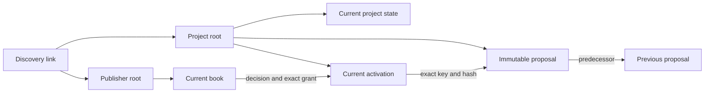

# Partfolk protocol v1

Partfolk turns separately owned offers of people, places and equipment into a plan that each required contributor can approve. Arkiv holds the public records; the clients derive feasibility, agreement and execution status from those records. A coordinator cannot approve another contributor's work.

This document describes the implemented `partfolk/1` protocol, schema version `1`, on Arkiv Tiramisu, chain ID `7738577`, using `@arkiv-network/sdk` `0.8.1`. See [operations](operations.md) for running the clients. The precise DTOs, validation and network projections are in [types.ts](../src/domain/types.ts), [validation.ts](../src/domain/validation.ts) and [envelope.ts](../src/data/arkiv/envelope.ts).

## Identity, values and provenance

An Arkiv root entity key is the stable project or publisher identity. Public keys are lowercase `0x` strings containing 32 bytes; wallet addresses contain 20 bytes. A publisher name is a label and can change. Two roots with the same name remain different identities.

Public records use UTF-8 JSON, `contentType: "application/json"`, `readonly: true` and `permissionlessExtension: false` (creation flags `1`). The reader checks the immutable creator, current owner, exact key or scope, chain, creation flags, schema, payload and indexed attributes. Creator and current owner must match. Transferring ownership makes a record unavailable to this creator-controlled workflow; retaining a familiar name does not restore its authority.

All seven payloads include `protocol`, `schemaVersion`, `entityType`, `operationId` and `createdAt`. `createdAt` and other application times are safe integer UTC milliseconds. Arkiv creation and expiration blocks are separate values; the application's JSON DTOs expose those block heights as decimal strings. Quantities and capacities are positive integers from `1` through `1,000,000`, paired with an explicit unit. Availability and work intervals are half-open: `[start, end)`. Adjacent intervals can meet without overlapping, but a gap in availability cannot be ignored.

Unknown fields, malformed references and duplicate identities are rejected. IDs must already use NFC Unicode and normalized newlines; labels and instructions may contain Unicode. The application caps each encoded payload at 120 KiB, below the SDK's 128 KiB payload ceiling. Records that exceed the limit must be dealt with explicitly; history is never silently truncated to make a write fit.

## The seven entity types

Every entity has these indexed attributes:

| Attribute | Arkiv type | Value |
| --- | --- | --- |
| `project` | `str` | `partfolk` application namespace |
| `entity_type` | `str` | One of the seven types below |
| `schema_version` | `i32` | `1` |
| `created_at` | `u64` | Payload `createdAt`, in UTC milliseconds |
| `operation_id` | `str` | The authored operation or persisted step ID |

Additional attributes are exact projections of payload fields. A matching query result is insufficient if its attributes disagree with its JSON. Extra attributes are also rejected.

| Type | Author | Main payload fields beyond the common fields | Additional indexed attributes |
| --- | --- | --- | --- |
| `project_root` | Coordinator wallet | `coordinator` | None |
| `project_state` | Project root's creator | `projectRoot`, `predecessorKeys`, editable `recipe`, admitted `publisherRoots`, `lifecycle`, `completedWork`, `completion` | `project_key: key` |
| `publisher_root` | Contributor wallet | `publisher`, `kind` (`individual` or `organization`) | None |
| `book_state` | Publisher root's creator | `publisherRoot`, `predecessorKeys`, name/description, `resources`, `offers`, `decisions`, `grants`, `attestations`, `custodyHolds`, `retentionDays` | `book_key: key` |
| `proposal` | Project root's creator | `projectRoot`, `requirementsHash`, `proposalHash`, complete `plan`, `changeExplanation` | `project_key: key`, `requirements_hash: bytes32`, `proposal_hash: bytes32` |
| `plan_activation` | Project root's creator | `projectRoot`, exact `proposalKey` and `proposalHash`, `predecessorActivationKeys` | `project_key: key`, `proposal_key: key` |
| `project_link` | Publisher for an offer; coordinator for a request | `linkKind`, `projectRoot`, `publisherRoot`; offers name `offerIds`; requests name `activationKey`, `proposalKey`, `proposalHash` | `project_key: key`, `publisher_key: key`, `link_kind: str`; requests also `activation_key: key` |



A project state is an editable draft and admission list. It contains no active-proposal pointer. The unique current activation supplies that authority. A book groups one publisher's resources, offers and authored decisions so that accepting work and replacing its capacity reservations happen together.

An offer link helps a coordinator discover a contribution. It does not admit the publisher or reserve anything. Admission requires a coordinator-authored project state containing that publisher root. A request link helps the owner find a proposal. It does not approve it. Stale links remain historical hints; invalid links carry diagnostics, and valid duplicates can collapse by identity.

## Current state and concurrent changes

For project states, books and activations, the reader evaluates the complete authenticated scope at one block:

| Result | Meaning |
| --- | --- |
| One valid current head | Usable current state |
| Zero heads after a complete read | Missing state; possibly not initialized, expired or deleted |
| Multiple valid heads | Conflict requiring explicit owner resolution |
| Malformed authored head or incomplete read | Unverified; never an empty successful result |

Clients must not select the newest timestamp, highest apparent revision or cached former head. A timestamp is not an ordering authority.

A normal transition creates the new readonly record and deletes the exact reviewed predecessor keys in one native Arkiv batch. Those deletes act as existence preconditions. If another successful transition already consumed a reviewed key, the stale transition cannot complete. This uses native entity mutations; there is no application smart contract or patch compare-and-swap API. Arkiv specifies ordered atomic batches in its [native mutation documentation](https://docs.arkiv.network/json-rpc/mutating-entities/).

This pattern does not prevent a malicious owner from creating another unconsumed head. Explicit fork resolution must review every authentic head, name all of them in `predecessorKeys` and `expectedHeads`, and consume all of them atomically. A concurrent change requires another read and review. Resolution must preserve recent immutable attestations and outstanding custody assertions; removing a live grant requires a durable withdrawal/decline or a validated replacement. Contradictory records cannot be silently merged by picking one timestamp. The resulting book still has to pass schema, capacity and authority checks.

Root initialization has two recoverable phases: create the root, then create its first state or book. If the response is lost, reconcile the same operation and reuse its confirmed root key. An invitation is shareable only after the root and initial state are confirmed. A lost response is not a reason to create a second identity.

## Immutable proposals and exact consent

A material plan includes the selected variant, venue and time zone; requirements, quantities, units and intervals; selected offer hashes; resource assumptions; allocations; conditions; instructions; all required approvers; explicit tasks, dependencies and equipment transfers; and its predecessor reference.

Every material promotion creates a new proposal and a new activation. Activation creation consumes the exact former activation. Merely creating a proposal does not make it active. Request links are delivered after activation as individually journaled steps, so interrupted delivery can resume without creating another proposal or activation.

The predecessor is the immediately preceding active source:

```text
{ projectRoot, activationKey, proposalKey, proposalHash }
```

The first proposal has a null predecessor. If P2 replaces P1 and the coordinator later restores P1's terms, the result is a new P3 with P2 as its predecessor. P1 cannot simply be reactivated. A restart after closure uses the recorded completion source as its predecessor. Reusing a recipe creates a new project root with no inherited predecessor or consent.

An edited `project_state.recipe` does not change the active immutable plan. `deriveDraftStatus` identifies the difference, and the interface separates draft changes from the agreed plan. An existing agreement badge does not approve new draft requirements.

Each decision and grant binds all four source fields. A valid current acceptance requires:

1. One accepted decision for the publisher's exact project and activation.
2. A grant naming that same project, activation, proposal key and proposal hash.
3. Exactly the publisher's selected offers and allocations from that plan.
4. Matching decision/grant operation ID and acceptance time.
5. A consent deadline later than the snapshot time and covering the publisher's final duty, including any return.
6. Current authenticated books, matching offer hashes and a plan that still passes the independent constraints.

Acceptance records the decision and grant in one replacement book. Decline or withdrawal records its decision and removes the corresponding grant. An accepted label without a matching grant is not agreement. Every new activation requires fresh approval from every required party, including contributors whose assignment stayed the same. Decisions for earlier activations remain history.

## Canonical hashes and independent validation

The reference implementation is [canonical.ts](../src/domain/canonical.ts); [the golden plan fixture](../src/domain/__tests__/fixtures/canonical-plan.json) and [canonical tests](../src/domain/__tests__/canonical-fixture.test.ts) support other clients.

Canonical encoding uses UTF-8 JSON, NFC strings, CRLF-to-LF normalization and lexicographically ordered object keys. Only safe integer numbers are accepted; negative zero becomes zero. Undefined values, class instances, cycles, nonfinite numbers and normalized key collisions fail. Set-like arrays sort by their specified identity and reject duplicates. Runbook array order remains meaningful; allocation and dependency references inside each duty are sorted sets.

The hash functions are precisely:

| Hash | Bytes passed to Keccak-256 |
| --- | --- |
| Offer | Canonical JSON of `{ domain: "partfolk/offer", protocol, validationVersion: 1, chainId, publisherRoot, offer: normalizeOffer(offer) }` |
| Requirements | Canonical JSON of `{ domain: "partfolk/requirements", protocol, validationVersion: 1, chainId, projectRoot, requirements }`, with normalized requirements sorted by ID |
| Proposal material | Canonical JSON of `normalizedPlan(plan)`; this object itself contains protocol, validation version, chain, project and predecessor. There is no extra hash wrapper. |
| Transfer statement | Canonical JSON of `{ protocol: "partfolk/1", purpose: "transfer_statement", statement }`, excluding the statement's own `statementHash` |

The proposal hash covers material plan terms. It excludes the outer proposal operation ID/creation time/change explanation, book entity keys, progress reports, decisions, receipts, cached timestamps and unselected recipe variants. An offer hash covers the offer's full normalized content, including its instructions. Equality of hashes is necessary but never substitutes for checking constraints against current resources and commitments.

The general solver searches integer allocations across valid variants and typed conditions: `requires_offer`, `excludes_offer`, `requires_capability`, `allowed_variants` and `allowed_venues`. Conditions are data, not executable scripts. Every emitted candidate passes a separate evaluator. Repair ranking minimizes, in order, removed publishers, changed variant, quantity changes and assignment-term changes, then uses the proposal hash for a stable tie break.

The search counts preprocessing and rejected allocation attempts against its node budget and checks elapsed time around synchronous work. It retains a bounded candidate list and at most 128 diagnostics. A stopped search reports `exhausted` or a found candidate with `optimality: "not_proven"`; it cannot claim impossibility or a proven best repair. The elapsed limit is cooperative at checkpoints, not a hard interrupt inside a single synchronous validation call.

## Work, reservations and equipment

All offers by an individual share the person's `self` resource with capacity one. Separate offer names cannot let the same person perform simultaneous tasks. Other resources have explicitly declared integer capacities. The evaluator checks both resource capacity and each offer's quantity.

A task must name allocations belonging to its publisher, match the linked requirement's use interval and preserve required predecessor tasks, directly or transitively. The same allocation cannot support duplicate tasks. Equipment allocations may remain without a use task when a remaining-work package still needs a transfer or return.

Equipment transfers name the owner, giver, receiver, resource, unit, quantity, time and supporting allocations. Finalization extends the equipment reservation from any earlier handover through a later planned return. The original required-use interval stays unchanged. Availability, capacity, approval and the material hash cover the full reservation.

A chronological inventory ledger checks planned transfers per owner/resource/unit and recipient. Goods leave the giver at transfer start and arrive at transfer end; a completed transfer can fund an adjacent one. Receiving one board does not permit returning six. Lending six boards to two recipients simultaneously is invalid. Splitting six boards between two recipients is valid, and re-lending returned stock is possible after the return completes. A matching outstanding hold from earlier work can support a remaining return; an unidentified historical recipient cannot be guessed. Already recorded continuation quantities and the current plan's own progress are not charged twice.

Unexpired grants reserve capacity even while the overall project still awaits other approvals. The evaluator includes overlapping grants for other projects. For a candidate replacing the same project's plan, it substitutes that publisher's candidate allocation once for the old project grant. Outstanding physical custody is combined with timed reservations per project without counting the same stock twice. Closing or cancelling a project does not release another owner's book or erase its custody holds.

## Readiness and its limits

Readiness is computed for a stated block and timestamp, not stored as a coordinator-controlled truth. The agreement health values are `possible`, `awaiting_approval`, `declined`, `ready`, `changed`, `conflict` and `unverified`. Solver feasibility, project lifecycle (`planning`, `in_progress`, `closed`), recorded outcome and evidence availability are separate dimensions. In particular, a draft with no activation can have `possible` agreement health without that label being a proof that a solver found a complete allocation.

`ready` means the current immutable plan is compatible with the observed books and every required publisher has a valid exact grant in the complete snapshot. It is not escrow, an atomic lock across multiple owners, a promise of future availability or proof of physical completion. Another owner can subsequently withdraw, delete or let a record expire. Wallet authorship establishes control of a key; it does not establish real-world identity, institutional status or resistance to multiple identities controlled by one person.

Readers obtain block B once, pin related entity queries and all pages to B, then confirm its canonical block hash. Cursor completion establishes a unique head; a second authenticated head already establishes a conflict. Failed pagination, exhausted page/entity limits, malformed authored data, rate limits and RPC failure never mean an empty usable scope. Cursor recovery restarts the whole scoped walk at the same block. See the [reader implementation](../src/data/arkiv/reader.ts) and Arkiv's [query API](https://docs.arkiv.network/json-rpc/querying-data/).

The default reader bounds are 160 pages, 4,000 entities, 50 project publishers, page size 100 and one cursor restart. The proposal lineage is bounded at 32 proposals. Snapshot confidence is limited to 60 seconds. Refresh before relying on a decision; a stale or failed read must remain dated last-known information and cannot authorize a new write.

| Condition | Representative reason codes | Required interpretation |
| --- | --- | --- |
| Identity, schema or hash failure | `foreign_author`, `owner_changed`, `projection_mismatch`, `invalid_schema`, `hash_mismatch` | Unverified record; no inferred consent |
| Missing current data | `missing_root`, `missing_state`, `missing_activation`, `missing_proposal`, `expired` | Unavailable state; distinguish from a complete never-initialized scope |
| Competing authored records | `conflicting_heads`, `contradictory_decision` | Conflict; owner review required |
| Read confidence failure | `incomplete_snapshot`, `stale_snapshot`, `rpc_error`, `page_budget`, `cursor_error` | Retry a complete fresh read; partial results are not authoritative |
| Changed plan or commitment | `offer_changed`, `capacity_exceeded`, `outside_availability`, `withdrawn`, `grant_expired` | Re-evaluate and obtain any necessary new approvals |
| Missing supporting history | `evidence_unavailable` | Keep the evidence gap visible; do not invent completion |

History traversal follows immutable predecessor proposal keys and validates creator, project, hash, chronology and cycles. Its `proposalHistoryStatus` is separate from current snapshot confidence. An unavailable old proposal does not by itself invalidate a complete current agreement, but it can prevent verification of historical or remaining-work evidence. There is no permanent readable archive guarantee.

## Expiration, renewal and recovery

Entity storage lifetime and consent are independent. Arkiv `expiresAtBlock` determines whether a record is live at B; `Grant.validUntil` is a UTC millisecond consent deadline evaluated using B's timestamp. Extending storage does not extend or revive consent.

Writes choose an explicit nominal storage duration. New books require at least the declared 90-day retention policy. Book replacement checks the greater of the retention horizon and each grant deadline plus a 60-second margin. The SDK converts a requested duration into block lifetime. Future block cadence is uncertain, so this admission check does not guarantee that an entity will remain live through a particular future UTC time. Owners must inspect and renew live records before expiration when continued availability is needed. Natural expiration supplies no event; fresh reads remain necessary.

A fresh complete zero-head book scope can be recovered under the same publisher root only while that root remains live, authentic and creator-owned. Recovery explicitly acknowledges missing state and starts an **empty** book: no cached resources, offers, decisions, grants, attestations or custody holds become public authority again. The owner must redeclare current availability before offering it. Known project evidence about outstanding equipment remains unresolved; missing storage does not mean returned equipment.

If the root itself expired, was deleted or has invalid authority, the contributor needs a new publisher identity and explicit admission of that new root. Concurrent empty-book recovery can create multiple heads; that is a conflict, not permission to choose whichever response arrived last.

## Execution, closure and exports

Task completion is an authored `task_report` tied to the exact source and obligation. A coordinator's `completedWork` reference is a retained claim, not substitute evidence. A transfer report records the named giver's statement; the receiver's acknowledgement binds the report's statement hash and an acknowledged quantity no greater than the report. Partial transfers remain partial. Corrections name the original assertion and require the same author/source/obligation and a later recorded time.

An owner's handover report creates a separate custody hold. Return reconciliation uses the matching parties, resources, source evidence and chronology. An earlier return cannot release a later handover. A verified partial return can reduce the outstanding quantity; full return or an explicit owner correction can release it. Consent expiry, closure and absence from a cache do not release physical custody. All such records remain participant assertions about physical events.

Remaining-work repair retains historical completion references, removes completed duties, reduces acknowledged transfer quantities and creates a new material package. Its new activation still requires fresh decisions from every required party. If evidence is missing, the history says so rather than upgrading a coordinator claim to proof.

Closure atomically replaces the project state and consumes the current activation. `completed` requires no outstanding duties or custody and available completion evidence. `completed_with_outstanding` and `cancelled` retain the stated exceptions. A closed project's outcome is historical, not a current agreement. Reopening does not turn old approvals into new consent.

Exports are dated JSON snapshots and standalone printable HTML containing the exact source, time zone, status and exceptions. Import and recipe reuse carry editable material, never third-party signing authority. Local roles and keys (`local-actor:…`, `local:…`, chain ID `null`) are explicit simulations. Public payload validation rejects those identities; a local sample acceptance cannot become an Arkiv approval by switching modes or importing a file.

## Evidence and trust boundary

The [native transition evidence](../arkiv/evidence/atomic-transition.json) records a successful A-to-B replacement and a stale A-to-C gas-estimation rejection, with only B live at the pinned check block. It explicitly records `staleBroadcast: false` and `minedRollbackTested: false`. That probe did not pay to mine a stale batch; the all-or-none guarantee comes from the cited native protocol specification. Local unit tests and mocked failure tests cover additional product rules, but do not constitute live multi-party network proof.

Product live-proof support is under [tests/arkiv-live](../tests/arkiv-live), including a [fresh-process CLI verification helper](../tests/arkiv-live/cli.ts). The full product live run remains pending; it was not executed as part of this documentation checkpoint. Until an inspected product evidence artifact records a completed run, the primitive probe must not be described as proof of the whole invitation, approval, withdrawal and repair journey. Deployment and user browser acceptance are also separate from code and domain verification.

Studio, the separately built Partner Desk and the fresh-process CLI share the published domain implementation and read Arkiv directly. Another compatible client can use the same records without a Studio session or private application database. This removes reliance on a running Studio host for participation and verification; it does not remove RPC/indexer dependence, owner control, coordinator admission or record expiration.

Public payloads and indexed attributes are public data. Expiration or deletion cannot retract copies already obtained by others. The demonstration uses synthetic participants and data. Private contact details, calendars and secrets do not belong in these public records.
