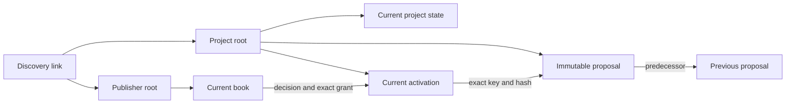

# Partfolk protocol v1

Partfolk turns separately owned offers of people, places and equipment into a plan that each required contributor can approve. Arkiv holds the public records; the clients derive feasibility, agreement and execution status from those records. A coordinator cannot approve another contributor's work.

This document describes the implemented `partfolk/1` protocol and its independent `partfolk-events/1` extension, each schema version `1`, on Arkiv Tiramisu, chain ID `7738577`, using `@arkiv-network/sdk` `0.8.1`. See [operations](operations.md) for running the clients. The precise core DTOs, validation and network projections are in [types.ts](../src/domain/types.ts), [validation.ts](../src/domain/validation.ts) and [envelope.ts](../src/data/arkiv/envelope.ts).

## Identity, values and provenance

An Arkiv root entity key is the stable project or publisher identity. Public keys are lowercase `0x` strings containing 32 bytes; wallet addresses contain 20 bytes. A publisher name is a label and can change. Two roots with the same name remain different identities.

Public records use UTF-8 JSON, `contentType: "application/json"`, `readonly: true` and `permissionlessExtension: false` (creation flags `1`). The reader checks the immutable creator, current owner, exact key or scope, chain, creation flags, schema, payload and indexed attributes. Creator and current owner must match. Transferring ownership makes a record unavailable to this creator-controlled workflow; retaining a familiar name does not restore its authority.

All seven payloads include `protocol`, `schemaVersion`, `entityType`, `operationId` and `createdAt`. `createdAt` and other application times are safe integer UTC milliseconds. Arkiv creation and expiration blocks are separate values; the application's JSON DTOs expose those block heights as decimal strings. Quantities and capacities are positive integers from `1` through `1,000,000`, paired with an explicit unit. Availability and work intervals are half-open: `[start, end)`. Adjacent intervals can meet without overlapping, but a gap in availability cannot be ignored.

Unknown fields, malformed references and duplicate identities are rejected. IDs must already use NFC Unicode and normalized newlines; labels and instructions may contain Unicode. The application caps each encoded payload at 120 KiB, below the SDK's 128 KiB payload ceiling. Records that exceed the limit must be dealt with explicitly; history is never silently truncated to make a write fit.

## The seven entity types

Every entity has these indexed attributes:

| Attribute | Arkiv type | Value |
| --- | --- | --- |
| `project` | `str` | `partfolk` application namespace |
| `entity_type` | `str` | One of the seven types below |
| `schema_version` | `i32` | `1` |
| `created_at` | `u64` | Payload `createdAt`, in UTC milliseconds |
| `operation_id` | `str` | The authored operation or persisted step ID |

Additional attributes are exact projections of payload fields. A matching query result is insufficient if its attributes disagree with its JSON. Extra attributes are also rejected.

| Type | Author | Main payload fields beyond the common fields | Additional indexed attributes |
| --- | --- | --- | --- |
| `project_root` | Coordinator wallet | `coordinator` | None |
| `project_state` | Project root's creator | `projectRoot`, `predecessorKeys`, editable `recipe`, admitted `publisherRoots`, `lifecycle`, `completedWork`, `completion` | `project_key: key` |
| `publisher_root` | Contributor wallet | `publisher`, `kind` (`individual` or `organization`) | None |
| `book_state` | Publisher root's creator | `publisherRoot`, `predecessorKeys`, name/description, `resources`, `offers`, `decisions`, `grants`, `attestations`, `custodyHolds`, `retentionDays` | `book_key: key` |
| `proposal` | Project root's creator | `projectRoot`, `requirementsHash`, `proposalHash`, complete `plan`, `changeExplanation` | `project_key: key`, `requirements_hash: bytes32`, `proposal_hash: bytes32` |
| `plan_activation` | Project root's creator | `projectRoot`, exact `proposalKey` and `proposalHash`, `predecessorActivationKeys` | `project_key: key`, `proposal_key: key` |
| `project_link` | Publisher for an offer; coordinator for a request | `linkKind`, `projectRoot`, `publisherRoot`; offers name `offerIds`; requests name `activationKey`, `proposalKey`, `proposalHash` | `project_key: key`, `publisher_key: key`, `link_kind: str`; requests also `activation_key: key` |



A project state is an editable draft and admission list. It contains no active-proposal pointer. The unique current activation supplies that authority. A book groups one publisher's resources, offers and authored decisions so that accepting work and replacing its capacity reservations happen together.

An offer link helps a coordinator discover a contribution. It does not admit the publisher or reserve anything. Admission requires a coordinator-authored project state containing that publisher root. A request link helps the owner find a proposal. It does not approve it. Stale links remain historical hints; invalid links carry diagnostics, and valid duplicates can collapse by identity.

## Current state and concurrent changes

For project states, books and activations, the reader evaluates the complete authenticated scope at one block:

| Result | Meaning |
| --- | --- |
| One valid current head | Usable current state |
| Zero heads after a complete read | Missing state; possibly not initialized, expired or deleted |
| Multiple valid heads | Conflict requiring explicit owner resolution |
| Malformed authored head or incomplete read | Unverified; never an empty successful result |

Clients must not select the newest timestamp, highest apparent revision or cached former head. A timestamp is not an ordering authority.

A normal transition creates the new readonly record and deletes the exact reviewed predecessor keys in one native Arkiv batch. Those deletes act as existence preconditions. If another successful transition already consumed a reviewed key, the stale transition cannot complete. This uses native entity mutations; there is no application smart contract or patch compare-and-swap API. Arkiv specifies ordered atomic batches in its [native mutation documentation](https://docs.arkiv.network/json-rpc/mutating-entities/).

This pattern does not prevent a malicious owner from creating another unconsumed head. Explicit fork resolution must review every authentic head, name all of them in `predecessorKeys` and `expectedHeads`, and consume all of them atomically. A concurrent change requires another read and review. Resolution must preserve recent immutable attestations and outstanding custody assertions; removing a live grant requires a durable withdrawal/decline or a validated replacement. Contradictory records cannot be silently merged by picking one timestamp. The resulting book still has to pass schema, capacity and authority checks.

Root initialization has two recoverable phases: create the root, then create its first state or book. If the response is lost, reconcile the same operation and reuse its confirmed root key. An invitation is shareable only after the root and initial state are confirmed. A lost response is not a reason to create a second identity.

## Immutable proposals and exact consent

A material plan includes the selected variant, venue and time zone; requirements, quantities, units and intervals; selected offer hashes; resource assumptions; allocations; conditions; instructions; all required approvers; explicit tasks, dependencies and equipment transfers; and its predecessor reference.

Every material promotion creates a new proposal and a new activation. Activation creation consumes the exact former activation. Merely creating a proposal does not make it active. Request links are delivered after activation as individually journaled steps, so interrupted delivery can resume without creating another proposal or activation.

The predecessor is the immediately preceding active source:

```text
{ projectRoot, activationKey, proposalKey, proposalHash }
```

The first proposal has a null predecessor. If P2 replaces P1 and the coordinator later restores P1's terms, the result is a new P3 with P2 as its predecessor. P1 cannot simply be reactivated. A restart after closure uses the recorded completion source as its predecessor. Reusing a recipe creates a new project root with no inherited predecessor or consent.

An edited `project_state.recipe` does not change the active immutable plan. `deriveDraftStatus` identifies the difference, and the interface separates draft changes from the agreed plan. An existing agreement badge does not approve new draft requirements.

Each decision and grant binds all four source fields. A valid current acceptance requires:

1. One accepted decision for the publisher's exact project and activation.
2. A grant naming that same project, activation, proposal key and proposal hash.
3. Exactly the publisher's selected offers and allocations from that plan.
4. Matching decision/grant operation ID and acceptance time.
5. A consent deadline later than the snapshot time and covering the publisher's final duty, including any return.
6. Current authenticated books, matching offer hashes and a plan that still passes the independent constraints.

Acceptance records the decision and grant in one replacement book. Decline or withdrawal records its decision and removes the corresponding grant. An accepted label without a matching grant is not agreement. Every new activation requires fresh approval from every required party, including contributors whose assignment stayed the same. Decisions for earlier activations remain history.

## Canonical hashes and independent validation

The reference implementation is [canonical.ts](../src/domain/canonical.ts); [the golden plan fixture](../src/domain/__tests__/fixtures/canonical-plan.json) and [canonical tests](../src/domain/__tests__/canonical-fixture.test.ts) support other clients.

Canonical encoding uses UTF-8 JSON, NFC strings, CRLF-to-LF normalization and lexicographically ordered object keys. Only safe integer numbers are accepted; negative zero becomes zero. Undefined values, class instances, cycles, nonfinite numbers and normalized key collisions fail. Set-like arrays sort by their specified identity and reject duplicates. Runbook array order remains meaningful; allocation and dependency references inside each duty are sorted sets.

The hash functions are precisely:

| Hash | Bytes passed to Keccak-256 |
| --- | --- |
| Offer | Canonical JSON of `{ domain: "partfolk/offer", protocol, validationVersion: 1, chainId, publisherRoot, offer: normalizeOffer(offer) }` |
| Requirements | Canonical JSON of `{ domain: "partfolk/requirements", protocol, validationVersion: 1, chainId, projectRoot, requirements }`, with normalized requirements sorted by ID |
| Proposal material | Canonical JSON of `normalizedPlan(plan)`; this object itself contains protocol, validation version, chain, project and predecessor. There is no extra hash wrapper. |
| Transfer statement | Canonical JSON of `{ protocol: "partfolk/1", purpose: "transfer_statement", statement }`, excluding the statement's own `statementHash` |

The proposal hash covers material plan terms. It excludes the outer proposal operation ID/creation time/change explanation, book entity keys, progress reports, decisions, receipts, cached timestamps and unselected recipe variants. An offer hash covers the offer's full normalized content, including its instructions. Equality of hashes is necessary but never substitutes for checking constraints against current resources and commitments.

The general solver searches integer allocations across valid variants and typed conditions: `requires_offer`, `excludes_offer`, `requires_capability`, `allowed_variants` and `allowed_venues`. Conditions are data, not executable scripts. Every emitted candidate passes a separate evaluator. Repair ranking minimizes, in order, removed publishers, changed variant, quantity changes and assignment-term changes, then uses the proposal hash for a stable tie break.

The search counts preprocessing and rejected allocation attempts against its node budget and checks elapsed time around synchronous work. It retains a bounded candidate list and at most 128 diagnostics. A stopped search reports `exhausted` or a found candidate with `optimality: "not_proven"`; it cannot claim impossibility or a proven best repair. The elapsed limit is cooperative at checkpoints, not a hard interrupt inside a single synchronous validation call.

## Work, reservations and equipment

All offers by an individual share the person's `self` resource with capacity one. Separate offer names cannot let the same person perform simultaneous tasks. Other resources have explicitly declared integer capacities. The evaluator checks both resource capacity and each offer's quantity.

A task must name allocations belonging to its publisher, match the linked requirement's use interval and preserve required predecessor tasks, directly or transitively. The same allocation cannot support duplicate tasks. Equipment allocations may remain without a use task when a remaining-work package still needs a transfer or return.

Equipment transfers name the owner, giver, receiver, resource, unit, quantity, time and supporting allocations. Finalization extends the equipment reservation from any earlier handover through a later planned return. The original required-use interval stays unchanged. Availability, capacity, approval and the material hash cover the full reservation.

A chronological inventory ledger checks planned transfers per owner/resource/unit and recipient. Goods leave the giver at transfer start and arrive at transfer end; a completed transfer can fund an adjacent one. Receiving one board does not permit returning six. Lending six boards to two recipients simultaneously is invalid. Splitting six boards between two recipients is valid, and re-lending returned stock is possible after the return completes. A matching outstanding hold from earlier work can support a remaining return; an unidentified historical recipient cannot be guessed. Already recorded continuation quantities and the current plan's own progress are not charged twice.

Unexpired grants reserve capacity even while the overall project still awaits other approvals. The evaluator includes overlapping grants for other projects. For a candidate replacing the same project's plan, it substitutes that publisher's candidate allocation once for the old project grant. Outstanding physical custody is combined with timed reservations per project without counting the same stock twice. Closing or cancelling a project does not release another owner's book or erase its custody holds.

## Readiness and its limits

Readiness is computed for a stated block and timestamp, not stored as a coordinator-controlled truth. The agreement health values are `possible`, `awaiting_approval`, `declined`, `ready`, `changed`, `conflict` and `unverified`. Solver feasibility, project lifecycle (`planning`, `in_progress`, `closed`), recorded outcome and evidence availability are separate dimensions. In particular, a draft with no activation can have `possible` agreement health without that label being a proof that a solver found a complete allocation.

`ready` means the current immutable plan is compatible with the observed books and every required publisher has a valid exact grant in the complete snapshot. It is not escrow, an atomic lock across multiple owners, a promise of future availability or proof of physical completion. Another owner can subsequently withdraw, delete or let a record expire. Wallet authorship establishes control of a key; it does not establish real-world identity, institutional status or resistance to multiple identities controlled by one person.

Readers obtain block B once, pin related entity queries and all pages to B, then confirm its canonical block hash. Cursor completion establishes a unique head; a second authenticated head already establishes a conflict. Failed pagination, exhausted page/entity limits, malformed authored data, rate limits and RPC failure never mean an empty usable scope. Cursor recovery restarts the whole scoped walk at the same block. See the [reader implementation](../src/data/arkiv/reader.ts) and Arkiv's [query API](https://docs.arkiv.network/json-rpc/querying-data/).

The default reader bounds are 160 pages, 4,000 entities, 50 project publishers, page size 100 and one cursor restart. The proposal lineage is bounded at 32 proposals. Snapshot confidence is limited to 60 seconds. Refresh before relying on a decision; a stale or failed read must remain dated last-known information and cannot authorize a new write.

| Condition | Representative reason codes | Required interpretation |
| --- | --- | --- |
| Identity, schema or hash failure | `foreign_author`, `owner_changed`, `projection_mismatch`, `invalid_schema`, `hash_mismatch` | Unverified record; no inferred consent |
| Missing current data | `missing_root`, `missing_state`, `missing_activation`, `missing_proposal`, `expired` | Unavailable state; distinguish from a complete never-initialized scope |
| Competing authored records | `conflicting_heads`, `contradictory_decision` | Conflict; owner review required |
| Read confidence failure | `incomplete_snapshot`, `stale_snapshot`, `rpc_error`, `page_budget`, `cursor_error` | Retry a complete fresh read; partial results are not authoritative |
| Changed plan or commitment | `offer_changed`, `capacity_exceeded`, `outside_availability`, `withdrawn`, `grant_expired` | Re-evaluate and obtain any necessary new approvals |
| Missing supporting history | `evidence_unavailable` | Keep the evidence gap visible; do not invent completion |

History traversal follows immutable predecessor proposal keys and validates creator, project, hash, chronology and cycles. Its `proposalHistoryStatus` is separate from current snapshot confidence. An unavailable old proposal does not by itself invalidate a complete current agreement, but it can prevent verification of historical or remaining-work evidence. There is no permanent readable archive guarantee.

## Expiration, renewal and recovery

Entity storage lifetime and consent are independent. Arkiv `expiresAtBlock` determines whether a record is live at B; `Grant.validUntil` is a UTC millisecond consent deadline evaluated using B's timestamp. Extending storage does not extend or revive consent.

Writes choose an explicit nominal storage duration. New books require at least the declared 90-day retention policy. Book replacement checks the greater of the retention horizon and each grant deadline plus a 60-second margin. The SDK converts a requested duration into block lifetime. Future block cadence is uncertain, so this admission check does not guarantee that an entity will remain live through a particular future UTC time. Owners must inspect and renew live records before expiration when continued availability is needed. Natural expiration supplies no event; fresh reads remain necessary.

A fresh complete zero-head book scope can be recovered under the same publisher root only while that root remains live, authentic and creator-owned. Recovery explicitly acknowledges missing state and starts an **empty** book: no cached resources, offers, decisions, grants, attestations or custody holds become public authority again. The owner must redeclare current availability before offering it. Known project evidence about outstanding equipment remains unresolved; missing storage does not mean returned equipment.

If the root itself expired, was deleted or has invalid authority, the contributor needs a new publisher identity and explicit admission of that new root. Concurrent empty-book recovery can create multiple heads; that is a conflict, not permission to choose whichever response arrived last.

## Execution, closure and exports

Task completion is an authored `task_report` tied to the exact source and obligation. A coordinator's `completedWork` reference is a retained claim, not substitute evidence. A transfer report records the named giver's statement; the receiver's acknowledgement binds the report's statement hash and an acknowledged quantity no greater than the report. Partial transfers remain partial. Corrections name the original assertion and require the same author/source/obligation and a later recorded time.

An owner's handover report creates a separate custody hold. Return reconciliation uses the matching parties, resources, source evidence and chronology. An earlier return cannot release a later handover. A verified partial return can reduce the outstanding quantity; full return or an explicit owner correction can release it. Consent expiry, closure and absence from a cache do not release physical custody. All such records remain participant assertions about physical events.

Remaining-work repair retains historical completion references, removes completed duties, reduces acknowledged transfer quantities and creates a new material package. Its new activation still requires fresh decisions from every required party. If evidence is missing, the history says so rather than upgrading a coordinator claim to proof.

Closure atomically replaces the project state and consumes the current activation. `completed` requires no outstanding duties or custody and available completion evidence. `completed_with_outstanding` and `cancelled` retain the stated exceptions. A closed project's outcome is historical, not a current agreement. Reopening does not turn old approvals into new consent.

Exports are dated JSON snapshots and standalone printable HTML containing the exact source, time zone, status and exceptions. Import and recipe reuse carry editable material, never third-party signing authority. Local roles and keys (`local-actor:…`, `local:…`, chain ID `null`) are explicit simulations. Public payload validation rejects those identities; a local sample acceptance cannot become an Arkiv approval by switching modes or importing a file.

## Public events and attendee decisions

The separately versioned `partfolk-events/1` extension adds a visitor's journey without changing the core contributor protocol. It uses namespace `partfolk-events`, schema version `1`, and the same public project-root identity. The [extension types](../src/domain/events/types.ts), [validation](../src/domain/events/validation.ts), [derived statuses](../src/domain/events/derived.ts) and [network adapter](../src/data/events/) are independent of the seven original payload types.

An immutable `event_release` contains a title, description, UTC start/end, named IANA time zone, public venue, preparation instructions and participation conditions. Legacy releases keep their original eight-field audience hash. Structured releases add `termsVersion: 2`, format, structured location, public online connection and registration rules to that hash. The release also keeps the original source plan, predecessor release key and optional owner-authorized reconfirmation accounts. An organizer-owned `event_state` points to the current release, repeats its dates for indexed discovery, records registration status and explicit admissions, and binds the current internal source plan. An attendee-owned `attendance_state` records a `going` request or `withdrawn` decision for the exact event, release key and audience hash. All three types use readonly, creator-owned records and strict typed projections. Releases/attendance are bounded to 64 KiB; state uses 120 KiB to fit all 512 reservations, below the installed SDK's 128 KiB payload-cell limit. The maximal state regression measures 120,700 bytes including 64 predecessor keys and maximal escaped operation ID; transaction/gas overhead remains separate. Existing `partfolk/1` and legacy event hashes are unchanged; older strict event readers fail closed on the new fields.

Participation is free. Unlimited open events allow direct joining; limited or invite-only events require an attendee request and an explicit organizer admission before showing a confirmed place. A coordinator can change, cancel or manage admissions but cannot sign an attendee's decision. Wallet identity and registration never establish a person's real-world identity or physical attendance. The public record includes the attendee's wallet and exact choice; the interface must disclose this before requesting a signature.

Structured formats are `online`, `in_person` and `hybrid`. Physical locations contain a two-letter country code, country, city and venue. Online/hybrid events provide a public HTTPS URL or public connection instructions; physical events have no online connection, and online events have no physical location. Public routing URL parameters and anchors are allowed; embedded credentials and known password/token parameters are rejected. This cannot detect arbitrary secrets in free text or links: meeting passwords and private access tokens must never be stored on the public chain. Invite-only means admission restricted to the release's public wallet list, not confidential event information.

Audience times and locations are organizer-published visitor conditions. Contributor signatures cover the exact linked preparation plan, whose tasks may include setup and teardown outside visitor hours. The protocol verifies both their authorship/versions and the source plan's current readiness; it does not automatically prove that visitor dates, venue, format or connection details correspond to those internal tasks. Organizers must review their compatibility. Publishing changed visitor details requires fresh audience consent, but does not itself create a new contributor proposal or imply contributor approval of those visitor fields.

Every structured release binds its registration deadline, unlimited/limited capacity, waiting-list policy and public invitation list. Limits are 1–512 places, with invitations and reservations each bounded to 512 entries and their respective payload bounds. A deadline may extend up to the event end, including during-event registration. Ordinary signup eligibility uses the authenticated creation block's timestamp, strictly before the deadline; caller timestamps are display metadata. A transaction prepared before the deadline but included at or after it can be recorded yet remains ineligible without an explicit owner-published reconfirmation exception. Existing timely attendance remains valid after the deadline; an organizer can admit a timely pending request afterward.

Limited places use an owner-controlled atomic roster. Each `event_state.admissions` entry contains `{attendee, attendanceKey, releaseKey}`. A `replaceEvent` command omitting `admissions` preserves it; an explicit array is the organizer's reviewed complete replacement. The native batch creates the successor state and deletes the exact reviewed predecessor. Concurrent owner decisions based on the same predecessor cannot both apply. No attendee writes a shared seat counter, no patch is presented as compare-and-swap, and no arbitrary contract is required. Attendance remains `pending` until its exact current request key and release appear in the verified roster. A waiting-list request requires explicit `joinWaitlist: true`; there is no automatic promotion.

Readers pin all attendance pages to the event snapshot, group by immutable creator, authenticate every current request and referenced release, and obtain/recheck creation-block headers. Queue presentation sorts by creation block ascending, then lowercase entity key ascending for ties. This reproducible order is a queue display, not automatic first-come seat assignment: the organizer chooses admissions. A missing/expired/forked attendee scope makes reservation evidence unverified and never releases capacity. A unique authenticated current decision by the same attendee keeps that wallet's obsolete reservation occupied without confirming the replacement, including repeated withdrawal/rejoin cycles. This does not reconstruct or trust deleted predecessor history. The organizer must explicitly remove or replace it. A release-only owner command requires the authenticated event envelope and exact predecessor, allowing recovery even when old roster/source evidence is missing; it cannot add an admission. Adding a place always requires complete verified current evidence.

New public terms carry the reserved roster forward. Publishing a lower capacity than the retained reservation count is rejected before any new release write; the organizer explicitly releases places first. Every changed condition requires attendee consent to the new release, then owner confirmation of the new request key for managed events. A retained attendee can reconfirm while full. Rejoining is a fresh request. Neither withdrawal nor record expiration auto-promotes another person; the organizer may explicitly release and promote in one bounded atomic transition. A reservation's current validity is established by a complete fresh read, not by a cached count or a successful wallet response alone.

The normal writer snapshots the reviewed predecessor's reserved wallets into immutable `event_release.reconfirmationAccounts`. First publication has an empty list; a caller cannot supply it. A listed wallet with a still-held current reservation can reconfirm that exact successor release after the deadline, while invitations and source readiness still apply. It remains pending until the owner binds the new exact request key. Releasing the reservation removes the exception. Independent readers authenticate this list as a coordinator-published deadline exception; they do not claim historical proof that every listed wallet previously registered on time. The organizer could use another client to publish deliberate exceptions. Ordinary attendees cannot authorize their own exception or automatically inherit confirmation. The readonly publisher's exact release key binds this metadata to attendee consent, independently of the audience comparison hash.

Unlimited open attendees have no held reservation, so late reconfirmation is not promised for them. Before a material terms-hash change with an already closed proposed deadline, the writer requires complete verified attendee evidence. Existing unreserved attendees with an authenticated active unlimited/open decision make that publication fail with an actionable instruction to explicitly move the deadline later, up to event end. This includes attendees who still need to review an earlier audience release after intervening publications. The organizer may instead use the separate close/cancel action. A partial roster or unavailable active decision is reported as unverified, not treated as an empty roster or a closed-registration decision. This guard does not apply to unchanged-term roster/status bookkeeping. Any general reopening is an explicit changed public condition, not a hidden exception.

Opening publication first stores the release, then atomically creates a current event state while consuming its reviewed predecessor. The operation journal retains both phases. Publication and every new or reconfirmed `going` decision require a complete fresh read of the exact current source plan with all required contributor agreements. That check runs again after unsigned wallet preparation. A contributor withdrawal or internal plan change derives `paused` regardless of an old stored `open` status. A coordinator can restore availability by binding a newly agreed source in the current event state without publishing another audience release.

A missing current state does not authorize resetting known publication history. If coordinator-authored releases still exist, fresh publication is refused. An interrupted first publication can finish only from its original journal and independently verified sole release. A lost release response is reconciled before creating the state; the release is not submitted again. Expiration or deletion that removes needed evidence remains an explicit gap.

New public terms require a new release and explicit attendee confirmation of that release key and hash. Restoring earlier visible terms also creates a new release; old decisions do not become current again. An internal source repair preserves the release key, so it leaves attendee confirmation intact. Attendance replacement atomically creates the person's successor decision and deletes their exact current head. Multiple heads fail closed; timestamps never select a winner. Withdrawal preserves the person's original release and hash even if the referenced event can no longer be read.

`closed` means registration is closed; reopening still needs fresh readiness. `cancelled` and `ended` are terminal event states. The scheduled end also prevents new joins. These statuses do not claim an attendee physically arrived. The immutable releases remain available until their explicit Arkiv expiration; a missing release or root is displayed as unavailable evidence, never an invented cancellation or confirmation.

The coordinator can cancel or close registration even when contributor evidence is unavailable. These operations still authenticate the project root, current event state and exact release, and preserve the previously published source reference. A terminal event page therefore remains readable after a source contributor expires. This exception never applies to opening, reopening or joining, and never substitutes for a missing or unauthenticated audience release.

`loadEvent` and `listMyEvents` accept a read-only `includeSource` option: omitted uses the public-page policy, `true` reads the source even for a closed event, and `false` authenticates only event envelopes even when their stored states are open. Organizers use that envelope read to reach close or cancel during a contributor RPC failure. Attendees can still authenticate their own current decision and withdraw during that failure. Omitting source reads does not establish source readiness or alter any write preflight.

The catalogue reads every page of the scoped event-state query at one canonical block, supports typed time filters, authenticates each candidate against its project root, then checks every authored current head without date/schema filters. Title, format, country/city, availability and deadline filters, and ordering, follow the complete read. My events uses a creator-scoped attendance query and joins both current and previously accepted public terms; a broken reference retains the registration entry and its diagnostic. Structured events expose the complete roster with chain inclusion time for each valid request. Both readers operate directly through Arkiv without a Studio cache. Page-budget, cursor and canonical-block failures cannot produce a partial authoritative list.

Source confidence is local to each event while the block and traversal budgets remain shared. An event with unavailable contributor evidence cannot mark an unrelated healthy event unverified. An actual interrupted page walk, RPC failure or inconsistent canonical block still rejects the complete list.

Event records and new or reconfirmed attendance require an explicit nominal lifetime covering the event end plus 30 days. The limit is a positive even number of seconds up to ten 366-day years. The SDK converts this to a block lifetime, so it is not a promise of UTC retention. Public event records need renewal planning outside this first extension; no background signer or automatic recreation is supplied. Transaction recovery reuses the original journal and the core verifier's exact sender/calldata/receipt/projection checks through an extension codec. The fixture tests establish these local rules; no live event-extension broadcast or browser acceptance is implied.

A saved interface action does not replace durable operation evidence. Every event mutation records its preflight attempt before validation or RPC work. A matching attempt that settles with rejection before entering native preparation can attest `not_sent` with `evidence: preflight-journal`, allowing a reviewed retry. An interrupted or missing preflight marker remains unresolved. Entering native preparation is recorded before any preparation wrapper runs; that marker cannot become a preflight rejection, and missing native records prevent direct retry.

After native preparation begins, reconciliation checks every observed step and known transaction against retained native records. A complete journal proving no send or a definitive wallet rejection attests `not_sent` with `evidence: native-journal`. Losing that journal after an uncertain wallet request leaves the action unresolved, even if the interface retained only its original intent. Missing, truncated or regressed native evidence stays `unverified`.

## Evidence and trust boundary

The [native transition evidence](../arkiv/evidence/atomic-transition.json) records a successful A-to-B replacement and a stale A-to-C gas-estimation rejection, with only B live at the pinned check block. It explicitly records `staleBroadcast: false` and `minedRollbackTested: false`. That probe did not pay to mine a stale batch; the all-or-none guarantee comes from the cited native protocol specification. Local unit tests and mocked failure tests cover additional product rules, but do not constitute live multi-party network proof.

Product live-proof support is under [tests/arkiv-live](../tests/arkiv-live), including a [fresh-process CLI verification helper](../tests/arkiv-live/cli.ts). The full product live run remains pending; it was not executed as part of this documentation checkpoint. Until an inspected product evidence artifact records a completed run, the primitive probe must not be described as proof of the whole invitation, approval, withdrawal and repair journey. Deployment and user browser acceptance are also separate from code and domain verification.

Studio, the separately built Partner Desk and the fresh-process CLI share the published domain implementation and read Arkiv directly. Another compatible client can use the same records without a Studio session or private application database. This removes reliance on a running Studio host for participation and verification; it does not remove RPC/indexer dependence, owner control, coordinator admission or record expiration.

Public payloads and indexed attributes are public data. Expiration or deletion cannot retract copies already obtained by others. The demonstration uses synthetic participants and data. Private contact details, calendars and secrets do not belong in these public records.
